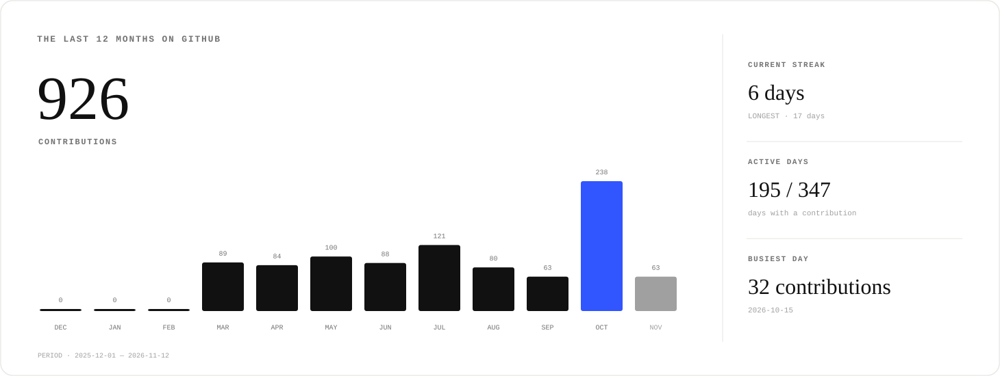
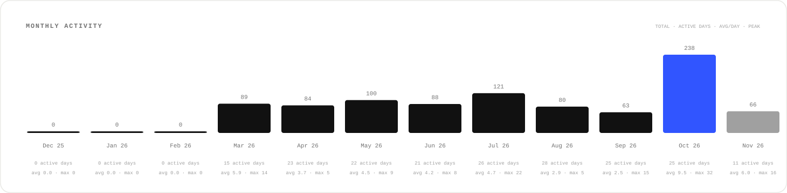
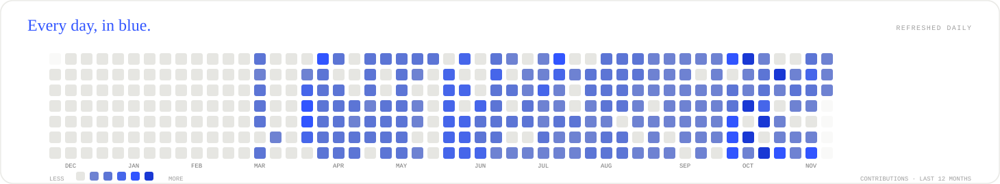
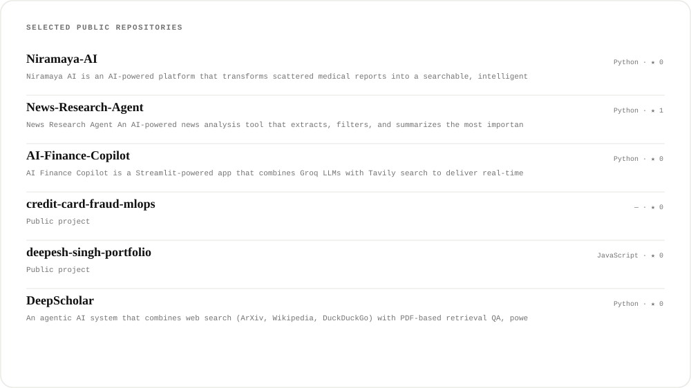

  

  <a href="https://deepesh-singh-portfolio.vercel.app/">Portfolio</a> &nbsp;·&nbsp;
  <a href="https://linkedin.com/in/contactdeepesh">LinkedIn</a> &nbsp;·&nbsp;
  <a href="https://github.com/singhdeepesh20">GitHub</a>

# Deepesh Singh

**Robotics & Automation Engineering Student · AI Engineer · AI Backend Developer**

I build AI-powered software with an interest in reliable backend systems, retrieval, and practical machine learning.

## About me

My work sits between AI engineering and backend development. I’m interested in how AI systems retrieve information, coordinate tools, and operate reliably beyond a prototype. I’m currently studying Robotics & Automation Engineering and learning by building.

## Technical expertise

- **AI engineering:** RAG systems, LLM applications, model integration, and evaluation
- **AI infrastructure:** asynchronous workflows, retrieval pipelines, and production AI systems
- **Systems:** backend engineering, API design, multi-agent systems, and machine learning

## Featured engineering projects

### Niramaya AI

My flagship engineering project. [Browse my repositories on GitHub](https://github.com/singhdeepesh20?tab=repositories).

## GitHub contribution overview

<!-- Generated daily from GitHub's contribution calendar. -->

## Monthly contribution analytics

## Blue contribution heatmap

## Featured repositories

## Connect with me

- [Portfolio](https://deepesh-singh-portfolio.vercel.app/)
- [LinkedIn](https://linkedin.com/in/contactdeepesh)
- [GitHub](https://github.com/singhdeepesh20)

---

Contribution cards refresh daily at 06:00 UTC using GitHub Actions.
